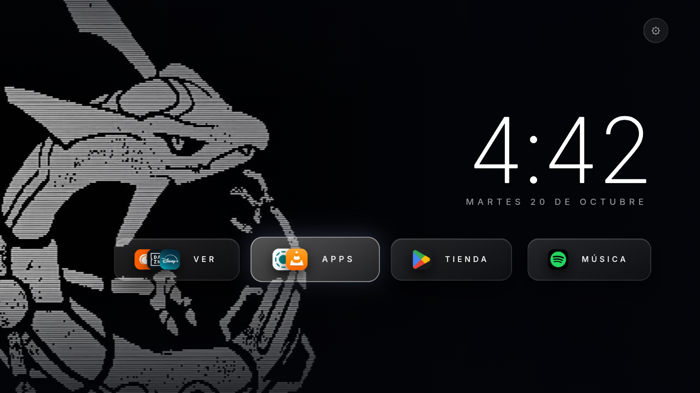
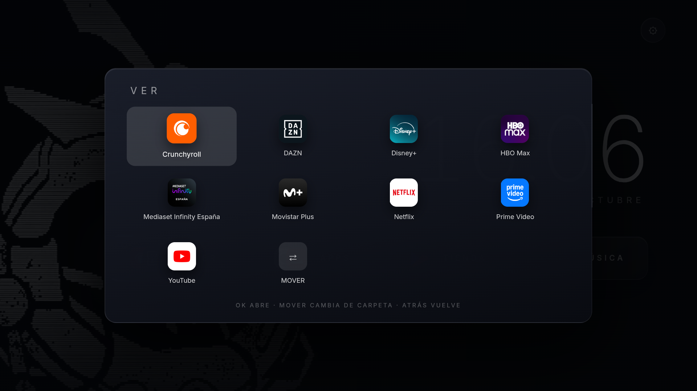
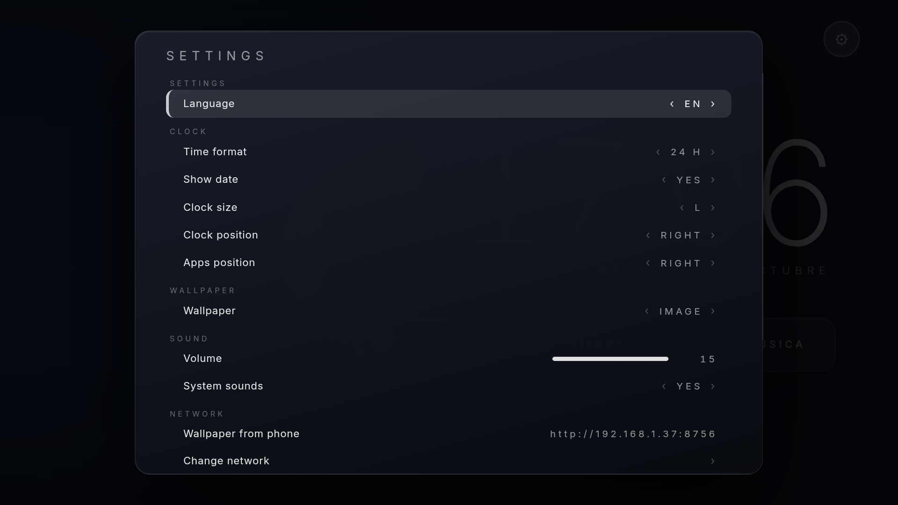

<p align="center">
<a href="https://github.com/elfleoncha/leontv-debloat/releases/latest"></a>
<a href="LICENSE"></a>


</p>

# LeonTV Debloat

Launcher **ultra minimalista** para Android TV, escrito en HTML/CSS/JS sobre un WebView nativo de ~160 KB. Sustituye el home lleno de anuncios por un reloj, tus apps en carpetas y un único botón de ajustes.

Nació de limpiar un **Xiaomi Mi TV Stick 4K (MiTV-AESP0, Android 9, 1 GB de RAM)**: pasó de 187 MB libres a **~360 MB** y de tirones constantes a una interfaz fluida.



## Qué incluye

- **Reloj grande + fecha** en español, tipografía Inter (empaquetada, sin red)
- **Carpetas de apps** con iconos apilados; cada carpeta abre una rejilla navegable con el mando
- **Auto-categoría**: cada app instalada cae en su carpeta según `ApplicationInfo.category` (+ heurística por paquete)
- **Tile MOVER** dentro de cada carpeta para reasignar apps a otra carpeta
- **Ajustes propios en HTML**: 12/24 h, fecha on/off, tamaño del reloj, posición del reloj y de las apps, fondo de pantalla, IP, RAM, almacenamiento, modelo, Android
- **Posiciones configurables**: reloj y apps a izquierda, centro o derecha
- **Home del mando funcionando** en mandos que envían `KEYCODE_ALL_APPS` (284) en vez de `HOME`, vía servicio de accesibilidad

| Carpetas | Ajustes |
|---|---|
|  |  |

## Cambiar el fondo desde el móvil

El launcher levanta un servidor web en el puerto **8756**. En Ajustes verás la URL exacta (`http://IP-DEL-STICK:8756`): ábrela desde el móvil en la misma Wi-Fi, elige una foto y se aplica al instante. Se guarda en el dispositivo y sobrevive a reinicios.

## Idiomas

Español, English, Italiano, Français, Deutsch y Português. Se cambia en **Ajustes → Idioma** y afecta a todo el panel, las pistas y los nombres de carpeta.

## Requisitos

- TV o stick con **Android TV / Google TV** (probado en Android 9)
- **ADB por red** activado (Ajustes → Información → pulsar *Build* 7 veces → Opciones de desarrollador → Depuración USB/ADB)
- Un PC en la misma red con `adb`

## Instalación en un comando

```bash
TV_IP=192.168.1.37 bash <(curl -fsSL https://raw.githubusercontent.com/elfleoncha/leontv-debloat/main/install.sh)
```

O en local:

```bash
git clone https://github.com/elfleoncha/leontv-debloat
cd leontv-debloat
TV_IP=192.168.1.37 ./install.sh
```

El script:
1. Conecta por ADB y acepta el diálogo de huella RSA en la TV
2. Instala `prebuilt/valenhome.apk` (o compila si tienes SDK y pasas `--build`)
3. Lo pone como **Home por defecto**
4. Activa el servicio de accesibilidad para la tecla Home del mando

## Debloat (opcional)

```bash
TV_IP=192.168.1.37 ./debloat.sh examples/xiaomi-mitv-aesp0/debloat.txt
```

Todo se aplica con `pm disable-user`: **nada se desinstala**. Para revertir:

```bash
adb shell pm enable <paquete>
# o el keep-list completo:
./debloat.sh --restore examples/xiaomi-mitv-aesp0/keep.txt
```

## Configuración

Las carpetas viven en el dispositivo:

```
/sdcard/Android/data/com.valen.home/files/folders.json
```

```json
{"folders":[
  {"name":"VER","apps":["com.netflix.ninja","com.disney.disneyplus","com.wbd.stream"]},
  {"name":"APPS","apps":["org.localsend.localsend_app","org.videolan.vlc"]}
]}
```

Las apps que no estén en ninguna carpeta se colocan automáticamente por categoría. Lo que muevas con el tile **MOVER** se guarda aparte y tiene prioridad.

## Rendimiento

| Ajuste | Efecto |
|---|---|
| WebView con `setBlockNetworkLoads(true)`, zoom y scroll desactivados | menos trabajo de red/layout |
| Iconos **WebP 72 px** en base64 | ~1 KB por icono en vez de 10 KB |
| Reloj alineado al minuto y sin escrituras de DOM si no cambia | 0 repintados por segundo |
| Reconstrucción de la home solo si cambió la lista de apps | sin parpadeos al volver |
| `show_stats` opcional | CPU/RAM/almacenamiento a la vista |

Comparativa en el Mi TV Stick 4K (1 GB):

| | RAM libre | Estado |
|---|---|---|
| Android TV de fábrica | 187 MB | tirones, anuncios |
| + debloat (65 paquetes) | 313 MB | fluido |
| + ValenHome + sin procesos en segundo plano | **~360 MB** | fluido y limpio |

El límite de procesos en segundo plano (`settings put global background_process_limit 0`) es opcional y agresivo: las apps se cierran al salir.

## Estructura

```
app/                  fuente Android (Java + assets HTML/CSS/JS)
prebuilt/             APK compilado listo para instalar
examples/             listas de debloat por modelo
screenshots/          capturas reales
install.sh            instalación en un comando
debloat.sh            aplicar/restaurar listas
```

## Compilar

```bash
export ANDROID_HOME=/ruta/android-sdk
./gradlew assembleDebug
# app/build/outputs/apk/debug/app-debug.apk
```

## Licencia

MIT. El repo incluye un fondo abstracto genérico: pon el tuyo en `app/src/main/assets/wallpaper.jpg` (1920×1080, oscuro, <300 KB) y recompila.
